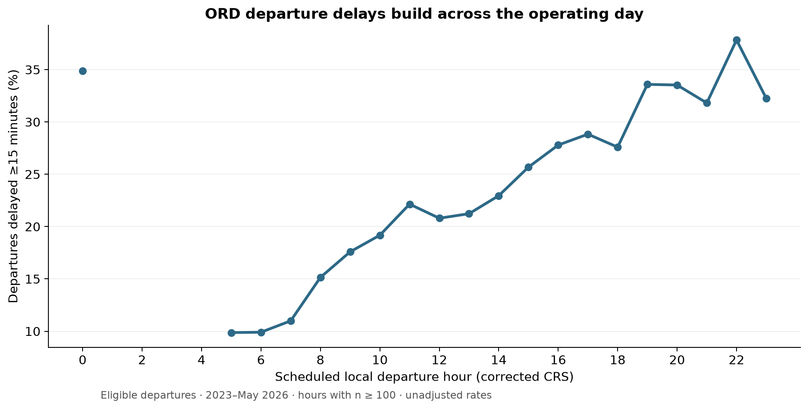
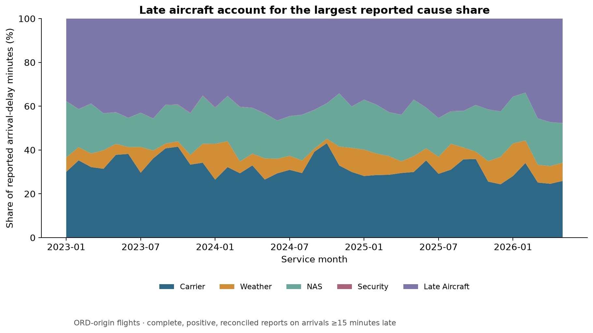

# ORD Flight Delay Analysis

This notebook explores gate-departure delays at Chicago O’Hare using Bureau of Transportation Statistics records from January 2023 through May 2026. It looks at departure hours, seasons, airline networks, destinations, taxi-out times, and reported delay reasons.

[Read the main EDA notebook](ord_departure_reliability_eda.ipynb) — all tables and 14 charts are already rendered. The [cleaning notebook](ord_data_cleaning.ipynb) shows the BTS schema fixes and how the analysis sample was selected.

| Measure | Result |
|---|---:|
| Service dates | 2023-01-01–2026-05-31 |
| Raw rows | 1,131,245 |
| Analysis-ready departures | 1,109,123 |
| Departures delayed ≥15 minutes | 22.97% |
| Mean / median departure delay | 16.06 / −2 minutes |

Delay rates rise from 9.91% at 06:00–06:59 to 37.83% at 22:00–22:59.

Late aircraft account for the largest share of reported arrival-delay minutes on ORD-origin flights.

To rerun, install `requirements.txt` and set the local data paths in the notebooks. Parquet files stay outside the repository; 2026 covers January–May only.

Giang Bui · Former air traffic controller transitioning into data science · [GPL-3.0](LICENSE)
